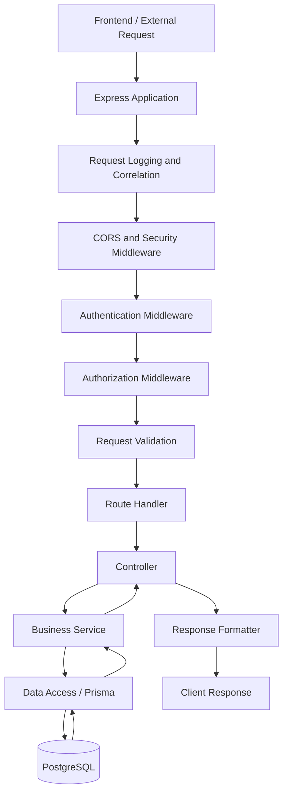

# Gadget Store — API Architecture

**Document:** API Architecture  
**Project:** Gadget Store E-commerce Platform  
**Status:** Proposed Architecture  
**API Style:** RESTful API  
**API Version:** v1  
**Backend:** Node.js + Express  
**Database:** PostgreSQL (Neon)  
**ORM:** Prisma  
**Validation:** Zod  
**Authentication:** Email and Password  
**Authorization:** Role-Based Access Control (RBAC)

---

## 1. Purpose

This document defines the API architecture for the Gadget Store platform.

It establishes how the two frontend applications communicate with the backend, how API resources are organized, how requests are processed and how access to protected operations is controlled.

The API serves as the central communication layer between:

- Storefront application.
- Admin dashboard.
- Backend business modules.
- PostgreSQL database.
- External services such as M-Pesa and email providers.

The API is responsible for enforcing business rules, validating incoming requests, protecting application data and coordinating operations across backend modules.

## 2. API Architecture Goals

The API should:

1. Provide a consistent communication interface for both frontend applications.
2. Separate HTTP handling from business logic.
3. Organize endpoints around business resources.
4. Enforce authentication and authorization.
5. Validate all incoming data.
6. Protect sensitive customer information.
7. Maintain order and inventory consistency.
8. Support reliable payment processing.
9. Provide predictable error responses.
10. Support future API expansion without breaking existing clients.

## 3. API Design Principles

### 3.1 RESTful Design

The API will follow REST conventions.

Resources will be represented using nouns, while HTTP methods will describe the requested operations.

Examples:

| HTTP Method | Purpose | Example |
|---|---|---|
| GET | Retrieve information | Get products |
| POST | Create a resource or initiate an operation | Create an order |
| PATCH | Partially update a resource | Update order status |
| PUT | Replace a resource representation | Replace a delivery address |
| DELETE | Remove a resource where permitted | Remove a cart item |

### 3.2 API Versioning

All initial API endpoints will use:

`/api/v1`

Example:

`/api/v1/products`

Versioning allows future API changes while providing a stable interface for existing frontend applications.

### 3.3 Resource-Oriented URLs

Use resource names rather than action-oriented endpoint names wherever practical.

For example:

- Preferred: `/api/v1/products`
- Avoid: `/api/v1/getAllProducts`

Operations that represent business commands, such as initiating checkout or payment, may use explicit action-oriented subpaths where appropriate.

### 3.4 Backend Authority

The backend is responsible for:

- Product price calculations.
- Inventory validation.
- Stock reservation.
- Order creation.
- Payment verification.
- Order status transitions.
- Customer ownership checks.
- Administrator authorization.

Frontend validation improves usability but does not replace backend validation.

---

## 4. API Consumers

The API has three main categories of consumers.

### 4.1 Storefront

The storefront consumes endpoints for:

- Product discovery.
- Search and filtering.
- Cart operations.
- Customer registration.
- Customer login.
- Customer profile.
- Checkout.
- Payment initiation.
- Order tracking.
- Order history.
- Cancellation requests.

### 4.2 Admin Dashboard

The admin dashboard consumes endpoints for:

- Administrator authentication.
- Dashboard statistics.
- Product management.
- Category management.
- Inventory management.
- Order management.
- Payment inspection.
- Delivery management.
- Basic reports.

### 4.3 External Services

External services communicate with selected backend endpoints.

M-Pesa uses payment integration endpoints for:

- Payment callbacks.
- Payment status verification where supported.
- Payment reconciliation.

External integrations must not receive general application access.

---

## 5. API Resource Architecture

The API will be organized into the following resource groups.

| Resource | Responsibility |
|---|---|
| Health | Application health and readiness |
| Authentication | Registration, login, logout and verification |
| Users | Customer profiles and account information |
| Products | Product catalog and product details |
| Categories | Product categories |
| Cart | Shopping cart management |
| Checkout | Checkout preparation and order creation |
| Orders | Order information and lifecycle management |
| Payments | Payment initiation and payment status |
| Inventory | Stock management and reservations |
| Delivery | Delivery details and fulfilment |
| Notifications | Notification records and delivery |
| Reports | Administrative reporting |
| Reviews | Product reviews (Phase 2) |
| Wishlist | Customer wishlists (Phase 2) |
| Promotions | Discounts and promotional rules (Phase 2) |

The resource groups represent logical API boundaries. They do not necessarily need to become separate Express applications.

---

## 6. Proposed API Endpoint Catalogue

The following catalogue defines the planned API surface for the MVP.

### 6.1 Health Endpoints

| Method | Endpoint | Purpose | Access |
|---|---|---|---|
| GET | `/api/v1/health` | Basic API health | Public |
| GET | `/api/v1/health/ready` | Check required dependencies | Internal/operational |

Health endpoints should reveal only necessary operational information, not secrets or sensitive infrastructure details.

### 6.2 Authentication Endpoints

| Method | Endpoint | Purpose | Access |
|---|---|---|---|
| POST | `/api/v1/auth/register` | Register a customer | Public |
| POST | `/api/v1/auth/login` | Customer login | Public |
| POST | `/api/v1/auth/logout` | End a customer session | Customer |
| GET | `/api/v1/auth/verify-email` | Verify customer email | Verification token |
| POST | `/api/v1/auth/resend-verification` | Resend verification message | Customer |
| POST | `/api/v1/auth/forgot-password` | Request password reset | Public |
| POST | `/api/v1/auth/reset-password` | Complete password reset | Reset token |
| GET | `/api/v1/auth/me` | Get authenticated account information | Customer/Admin |

Administrator accounts must be provisioned through a controlled process. Public registration must never create administrator accounts.

Administrator authentication may use a separate login interface while sharing the backend authentication infrastructure.

### 6.3 Customer Endpoints

| Method | Endpoint | Purpose | Access |
|---|---|---|---|
| GET | `/api/v1/users/me` | Retrieve own profile | Customer |
| PATCH | `/api/v1/users/me` | Update own profile | Customer |
| GET | `/api/v1/users/me/addresses` | List own addresses | Customer |
| POST | `/api/v1/users/me/addresses` | Add delivery address | Customer |
| PATCH | `/api/v1/users/me/addresses/:id` | Update own address | Customer |
| DELETE | `/api/v1/users/me/addresses/:id` | Remove own address | Customer |

Customer endpoints must enforce resource ownership.

### 6.4 Product Endpoints

| Method | Endpoint | Purpose | Access |
|---|---|---|---|
| GET | `/api/v1/products` | List active products | Public |
| GET | `/api/v1/products/:id` | Get product details | Public |
| POST | `/api/v1/products` | Create product | Admin |
| PATCH | `/api/v1/products/:id` | Update product | Admin |
| DELETE | `/api/v1/products/:id` | Archive or deactivate product | Admin |
| GET | `/api/v1/admin/products` | Administrative product listing | Admin |

Product listing should support:

- Pagination.
- Search.
- Category filtering.
- Brand filtering.
- Price range filtering.
- Availability filtering.
- Sorting.

The backend must ensure that public queries do not expose inactive products.

Product deletion should normally use deactivation or archival when historical orders reference the product.

### 6.5 Category Endpoints

| Method | Endpoint | Purpose | Access |
|---|---|---|---|
| GET | `/api/v1/categories` | List public categories | Public |
| GET | `/api/v1/categories/:id` | Get category details | Public |
| POST | `/api/v1/categories` | Create category | Admin |
| PATCH | `/api/v1/categories/:id` | Update category | Admin |
| DELETE | `/api/v1/categories/:id` | Deactivate category | Admin |

### 6.6 Cart Endpoints

| Method | Endpoint | Purpose | Access |
|---|---|---|---|
| GET | `/api/v1/cart` | Retrieve current cart | Guest/Customer |
| POST | `/api/v1/cart/items` | Add item to cart | Guest/Customer |
| PATCH | `/api/v1/cart/items/:id` | Update item quantity | Guest/Customer |
| DELETE | `/api/v1/cart/items/:id` | Remove cart item | Guest/Customer |
| DELETE | `/api/v1/cart` | Clear cart | Guest/Customer |

Guest cart identity must be managed securely. A guest must not be able to access another guest's cart by guessing an identifier.

Cart contents are not proof of available inventory or final product prices.

### 6.7 Checkout Endpoints

| Method | Endpoint | Purpose | Access |
|---|---|---|---|
| POST | `/api/v1/checkout` | Validate cart and prepare checkout order | Guest/Customer |
| GET | `/api/v1/checkout/:id` | Retrieve own checkout summary | Checkout owner |
| POST | `/api/v1/checkout/:id/cancel` | Cancel eligible unpaid checkout | Checkout owner |

Checkout preparation must:

1. Validate submitted customer and delivery information.
2. Retrieve current product prices.
3. Validate product status.
4. Validate inventory.
5. Calculate order subtotal.
6. Include the applicable delivery fee.
7. Create the order.
8. Reserve stock for 15 minutes.
9. Record the reservation expiry.

The backend must not trust totals submitted by the frontend.

### 6.8 Order Endpoints

| Method | Endpoint | Purpose | Access |
|---|---|---|---|
| GET | `/api/v1/orders` | Retrieve own orders | Customer |
| GET | `/api/v1/orders/:id` | Retrieve own order | Owner/Admin |
| POST | `/api/v1/orders/:id/cancel-requests` | Request eligible cancellation | Owner |
| GET | `/api/v1/admin/orders` | List all orders | Admin |
| PATCH | `/api/v1/admin/orders/:id/fulfilment` | Update fulfilment status | Admin |

Guest order access should use a secure, unpredictable token or equivalent verification mechanism.

Sequential order IDs must never be sufficient to expose private order information.

The API must enforce valid order status transitions.

### 6.9 Payment Endpoints

| Method | Endpoint | Purpose | Access |
|---|---|---|---|
| POST | `/api/v1/payments/mpesa/initiate` | Initiate M-Pesa payment | Checkout owner |
| GET | `/api/v1/payments/:id` | Retrieve own payment status | Payment owner |
| POST | `/api/v1/payments/mpesa/callback` | Receive payment callback | Verified external service |
| POST | `/api/v1/admin/payments/reconcile` | Request reconciliation | Admin/controlled internal operation |
| GET | `/api/v1/admin/payments` | Inspect payment records | Admin |

The exact callback authentication mechanism must follow the selected M-Pesa API's supported security and verification procedures.

The payment module must:

- Match payment references to expected orders.
- Verify the amount and transaction details.
- Prevent duplicate callback processing.
- Record unsuccessful transactions.
- Support payment reconciliation.
- Keep refunds as separately recorded operations.

An administrator cannot manually mark an unverified payment as paid.

### 6.10 Inventory Endpoints

| Method | Endpoint | Purpose | Access |
|---|---|---|---|
| GET | `/api/v1/admin/inventory` | View inventory | Admin |
| GET | `/api/v1/admin/inventory/low-stock` | View low-stock products | Admin |
| PATCH | `/api/v1/admin/inventory/:productId` | Adjust stock | Admin |
| GET | `/api/v1/admin/inventory/:productId/movements` | View stock history | Admin |

Stock reservation and release are primarily internal business operations coordinated by checkout, order and payment services.

Public clients must not directly control reserved stock quantities.

### 6.11 Delivery Endpoints

| Method | Endpoint | Purpose | Access |
|---|---|---|---|
| GET | `/api/v1/orders/:id/delivery` | View own delivery information | Order owner |
| GET | `/api/v1/admin/deliveries` | View deliveries | Admin |
| PATCH | `/api/v1/admin/orders/:id/delivery` | Assign delivery information and fee | Admin |

Delivery fees must be visible to customers before payment.

Changes to delivery charges after payment require explicit customer agreement and an appropriate payment adjustment.

### 6.12 Reporting Endpoints

| Method | Endpoint | Purpose | Access |
|---|---|---|---|
| GET | `/api/v1/admin/reports/overview` | Dashboard overview | Admin |
| GET | `/api/v1/admin/reports/sales` | Sales summary | Admin |
| GET | `/api/v1/admin/reports/orders` | Order statistics | Admin |
| GET | `/api/v1/admin/reports/inventory` | Inventory summary | Admin |
| GET | `/api/v1/admin/reports/best-sellers` | Best-selling products | Admin |

Reports must be generated using authoritative database records.

### 6.13 Future API Resources

These endpoints are not part of the initial MVP.

**Reviews**

- Create a product review.
- Retrieve product reviews.
- Update or moderate reviews.

**Wishlist**

- Retrieve wishlist.
- Add product to wishlist.
- Remove product from wishlist.

**Promotions**

- Create promotional rules.
- Validate discount eligibility.
- Apply discounts during checkout.

These features should be introduced after the core e-commerce workflows are stable.

---

## 7. Request and Response Standards

### 7.1 Request Format

The API will use JSON for ordinary request and response bodies.

Requests should include the appropriate content type.

Product image uploads may use multipart form data or a direct-to-object-storage upload workflow.

### 7.2 Success Responses

Successful responses should be consistent and predictable.

A response may contain:

- Success indicator.
- Human-readable message.
- Requested data.
- Pagination metadata where relevant.

### 7.3 Error Responses

Errors should use appropriate HTTP status codes.

| Status | Meaning | Example |
|---|---|---|
| 200 | OK | Successful retrieval |
| 201 | Created | Product or order created |
| 204 | No Content | Successful deletion without response body |
| 400 | Bad Request | Invalid request data |
| 401 | Unauthorized | Missing or invalid authentication |
| 403 | Forbidden | Authenticated user lacks permission |
| 404 | Not Found | Resource does not exist or is not accessible |
| 409 | Conflict | Insufficient stock or conflicting state |
| 422 | Unprocessable Content | Semantically invalid operation |
| 429 | Too Many Requests | Rate limit exceeded |
| 500 | Internal Server Error | Unexpected server failure |
| 503 | Service Unavailable | Required dependency unavailable |

The API must avoid returning internal stack traces, credentials or sensitive implementation details to clients.

### 7.4 Error Structure

Errors should follow one predictable format with:

- A machine-readable error code.
- A safe human-readable message.
- Optional field validation details.
- A request correlation identifier where available.

---

## 8. Pagination, Filtering and Sorting

Product listings, orders and administrative collections must support pagination.

The API should define consistent query parameters.

Examples of supported concepts:

| Parameter | Purpose |
|---|---|
| page | Page number |
| limit | Maximum records per page |
| search | Search term |
| category | Category filter |
| minPrice | Minimum price |
| maxPrice | Maximum price |
| sortBy | Sorting field |
| order | Ascending or descending |

The backend must enforce reasonable pagination limits.

It must validate sorting fields rather than accepting arbitrary database field names.

---

## 9. Authentication and Authorization

### 9.1 Authentication

The API supports:

- Customer email/password registration.
- Email verification.
- Customer login and logout.
- Administrator login.
- Password reset.
- Secure session management.

The session or token strategy must be selected during implementation.

For browser-based applications, secure, HTTP-only cookies are a suitable approach to consider, with appropriate CSRF protection where required.

### 9.2 Authorization

The backend uses Role-Based Access Control.

Initial application actors:

- Guest.
- Customer.
- Administrator.

M-Pesa uses separate service-to-service authentication.

### 9.3 Authorization Rules

- Public endpoints must expose only public information.
- Customer endpoints must enforce ownership.
- Administrator endpoints must require administrator authorization.
- Payment callbacks must be independently verified.
- Sensitive operations must be denied by default.
- Frontend route protection must never replace backend authorization.

---

## 10. Validation and Security

Every incoming request must be validated by the backend.

Validation should cover:

- Required fields.
- Data types.
- String lengths.
- Email formats.
- Phone number formats.
- Numeric ranges.
- Product quantities.
- Allowed status transitions.
- Resource ownership.
- Business rules.

Additional security controls:

- HTTPS in production.
- Secure password hashing.
- Rate limiting.
- Secure session handling.
- CORS origin restrictions.
- Protection against common web vulnerabilities.
- Secure secret management.
- Request size limits.
- Safe error handling.
- Administrative audit logging.

Sensitive payment and authentication operations require additional monitoring and protection.

---

## 11. API Processing Architecture

Requests should pass through a predictable backend processing pipeline.

Not every request needs authentication. Public endpoints should be explicitly identified and protected endpoints should require the appropriate checks.

Errors should be handled centrally.

---

## 12. Transaction and Idempotency Requirements

The API must protect operations where repeated requests or concurrent actions could cause inconsistent results.

### 12.1 Database Transactions

Use database transactions for operations that must succeed or fail together.

Examples:

- Creating an order and reserving stock.
- Finalizing stock deduction after payment.
- Releasing expired reservations.
- Processing approved cancellations.

### 12.2 Idempotency

Idempotency means that repeating the same operation does not produce duplicate business effects.

It is especially important for:

- Payment callbacks.
- Payment initiation retries.
- Order submission retries.
- Reservation expiration processing.

Payment callback handling must be safe when M-Pesa sends the same callback more than once.

### 12.3 Concurrency

The backend must safely handle multiple customers attempting to purchase the same limited inventory.

Stock reservation must be atomic or use suitable database locking/conditional updates.

The system must not rely on a frontend stock check as a guarantee of availability.

---

## 13. API Performance and Reliability

The API must support the approved technical requirements.

| Requirement | Target |
|---|---|
| Ordinary API response performance | p95 ≤ 500 ms under agreed test load |
| Monthly availability | 99.5% |
| API architecture | Versioned REST API |
| Backend deployment | Horizontally scalable |
| Database | Managed PostgreSQL |
| Critical operations | Automated tests |
| Payment processing | Idempotent and reconcilable |

External provider response times should be monitored separately from ordinary internal API response times.

Slow external operations should not unnecessarily block unrelated API requests.

---

## 14. API Testing Strategy

API testing must cover the following categories.

### Authentication Tests

- Successful registration.
- Duplicate email rejection.
- Invalid login rejection.
- Email verification.
- Unauthorized access rejection.
- Password reset.

### Product Tests

- Product listing.
- Product search.
- Product filtering.
- Product detail retrieval.
- Admin product creation and updates.
- Inactive product visibility.

### Cart and Checkout Tests

- Adding cart items.
- Updating quantities.
- Invalid quantity rejection.
- Backend price calculation.
- Insufficient inventory.
- Stock reservation.
- Reservation expiry.

### Payment Tests

- Successful payment callback.
- Failed payment callback.
- Invalid callback.
- Duplicate callback.
- Amount mismatch.
- Delayed payment confirmation.
- Payment reconciliation.

### Order Tests

- Order creation.
- Customer order ownership.
- Admin order access.
- Invalid status transition.
- Cancellation eligibility.
- Stock restoration where appropriate.

### Security Tests

- Customer accessing another customer's order.
- Guest accessing another guest's order.
- Customer accessing administrator endpoints.
- Unauthenticated access to protected endpoints.
- Unauthorized inventory modifications.
- Invalid payment callbacks.

---

## 15. API Documentation and Maintenance

The API should have machine-readable documentation.

OpenAPI is the recommended standard.

An OpenAPI specification can document:

- Endpoints.
- HTTP methods.
- Parameters.
- Request bodies.
- Response formats.
- Authentication requirements.
- Error responses.
- Example requests and responses.

API documentation should be updated whenever endpoint contracts change.

The documentation should remain consistent with the implementation.

---

## 16. API Architecture Acceptance Criteria

The API architecture is approved when:

- [ ] API consumers and responsibilities are defined.
- [ ] REST conventions are established.
- [ ] API versioning is defined.
- [ ] MVP resource groups are identified.
- [ ] Endpoint catalogue is documented.
- [ ] Authentication boundaries are defined.
- [ ] Authorization requirements are defined.
- [ ] Customer ownership rules are documented.
- [ ] Request validation standards are defined.
- [ ] Response and error conventions are established.
- [ ] Pagination and filtering are planned.
- [ ] Payment callback security is defined.
- [ ] Transaction and idempotency requirements are documented.
- [ ] API testing strategy is defined.
- [ ] API documentation standards are established.

---

## 17. Conclusion

The Gadget Store API will be a versioned REST API built with Express and organized around clearly defined business resources.

It will serve both frontend applications while maintaining a single authoritative location for business logic, authentication, authorization, inventory management, order processing and payment verification.

The API architecture provides a consistent contract between frontend and backend teams and prepares the project for implementation.

**Architecture decision:** Build one versioned REST API within the modular monolith. Keep business rules in backend services, validate all requests and enforce authorization on the server.
