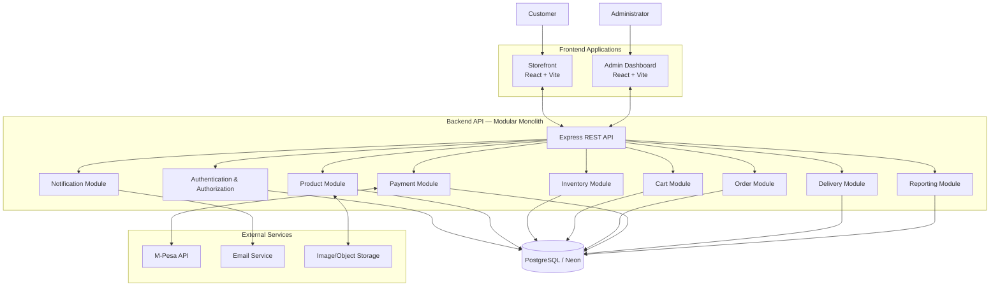
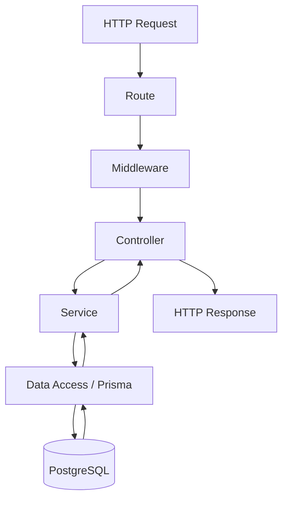
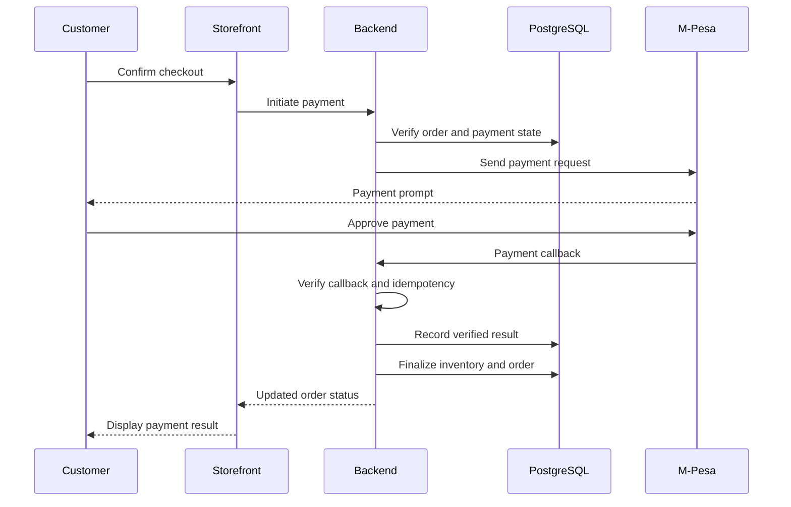

# Gadget Store — System Architecture

**Document:** System Architecture  
**Project:** Gadget Store E-commerce Platform  
**Status:** Proposed Architecture  
**Architecture Style:** Modular Monolith  
**Backend Pattern:** Layered Architecture  
**Frontend Architecture:** Independent Applications  
**Database:** PostgreSQL (Neon)

---

## 1. Architecture Overview

### 1.1 Purpose

This document describes the overall technical architecture of the Gadget Store platform.

It defines how the storefront, admin dashboard, backend API, database and external services interact to deliver the required e-commerce functionality.

The architecture will guide implementation decisions and establish clear boundaries between system components.

### 1.2 Architecture Goals

The architecture is designed to:

- Support a complete e-commerce shopping experience.
- Separate customer-facing and administrative interfaces.
- Centralize business logic in the backend.
- Maintain secure communication between system components.
- Protect customer information and payment operations.
- Prevent inventory inconsistencies and overselling.
- Support future horizontal scaling.
- Allow additional features without restructuring the entire application.
- Keep the initial implementation manageable.

### 1.3 Architectural Decisions

| Area | Decision |
|---|---|
| Architecture style | Modular monolith |
| Frontend structure | Two independent applications |
| Storefront | React + Vite |
| Admin dashboard | React + Vite |
| Backend | Node.js + Express |
| Backend modules | Domain-oriented modules |
| API style | RESTful API |
| API versioning | `/api/v1` |
| Database | PostgreSQL |
| Database hosting | Neon |
| ORM | Prisma |
| Validation | Zod |
| Authentication | Email and password |
| Authorization | Role-Based Access Control |
| Payment | M-Pesa |
| Currency | KES |
| Repository | Monorepo without npm workspaces |

---

## 2. High-Level System Architecture

The platform consists of five main components:

1. Storefront application.
2. Admin dashboard application.
3. Backend API.
4. PostgreSQL database.
5. External services.

### 2.1 System Architecture Diagram



The diagram represents logical responsibilities, not separate deployed backend services. All backend modules initially run within one backend application.

### 2.2 Communication Principles

- The storefront communicates with the backend through HTTP APIs.
- The admin dashboard communicates with the same backend API.
- The backend is the only application component that directly accesses PostgreSQL.
- The backend communicates with M-Pesa for payment operations.
- M-Pesa sends payment callbacks to the backend.
- The backend communicates with external email and image storage services.
- Frontend applications never receive database credentials or payment secrets.

---

## 3. Frontend Architecture

The frontend consists of two independent React applications.

### 3.1 Storefront Application

**Location:** `apps/storefront`

**Technology:** React + Vite

The storefront is the customer-facing application.

Responsibilities:

- Display the homepage.
- Display product categories.
- Display product listings.
- Display product details and specifications.
- Search and filter products.
- Manage shopping cart interactions.
- Handle customer registration and login.
- Collect checkout information.
- Initiate checkout and payment requests.
- Display order confirmations.
- Allow customers to track their orders.
- Display customer profile and order history.

The storefront must not contain business-critical pricing, stock deduction or payment verification logic.

These responsibilities belong to the backend.

### 3.2 Admin Dashboard Application

**Location:** `apps/admin`

**Technology:** React + Vite

The admin dashboard is a separate application intended for authorized store administrators.

Responsibilities:

- Administrator authentication.
- Dashboard overview.
- Product management.
- Category management.
- Product image management.
- Inventory management.
- Order management.
- Payment status monitoring.
- Delivery management.
- Basic sales and inventory reporting.

The admin dashboard uses the same backend API as the storefront.

A separate frontend does not provide automatic security. All administrator permissions must be verified by the backend.

### 3.3 Frontend Communication

Both frontend applications communicate with the backend using REST API requests.

Development origins:

| Application | Local URL |
|---|---|
| Storefront | `http://localhost:5173` |
| Admin dashboard | `http://localhost:5174` |
| Backend API | `http://localhost:3780` |

Production deployment will use HTTPS and separate frontend deployment origins or subdomains.

---

## 4. Backend Architecture

### 4.1 Architecture Style

The backend will use a **Modular Monolith**.

A modular monolith is one deployable backend application internally divided into independent functional modules.

Instead of building multiple microservices, we will maintain one Express application with clearly separated responsibilities.

### 4.2 Why a Modular Monolith?

It provides:

- Simpler initial deployment.
- Easier development and debugging.
- Lower infrastructure complexity.
- Easier database transaction management.
- Clear boundaries between business domains.
- A future path to extract individual services if genuinely necessary.

Microservices are not required for the initial project.

### 4.3 Backend Modules

The backend will be divided into the following logical modules.

| Module | Responsibilities |
|---|---|
| Authentication | Registration, login, sessions and account verification |
| Users | Customer profiles and account information |
| Products | Product information, categories and product visibility |
| Inventory | Stock levels, reservations and stock adjustments |
| Cart | Shopping cart operations |
| Orders | Order creation, order details and fulfilment lifecycle |
| Payments | M-Pesa initiation, callbacks and payment reconciliation |
| Delivery | Delivery fees and delivery status |
| Notifications | Customer email notifications |
| Reviews | Product reviews (Phase 2) |
| Wishlist | Customer wishlists (Phase 2) |
| Promotions | Discounts and promotional rules (Phase 2) |
| Reports | Sales, order and inventory reports |

Each module owns its business responsibilities and should expose clearly defined operations to other modules.

### 4.4 Backend Layered Architecture

Each module should follow a consistent separation of responsibilities.

**Routes**

Define API endpoints and connect requests to the appropriate middleware and controllers.

**Middleware**

Handle cross-cutting concerns such as authentication, authorization, validation and request processing.

**Controllers**

Receive HTTP requests, extract relevant information and return HTTP responses.

Controllers should remain relatively lightweight.

**Services**

Contain business rules and application operations.

For example, the order service coordinates order creation, pricing, stock reservation and payment preparation.

**Repositories / Data Access**

Handle database queries and persistence where a separate data-access layer provides value.

Prisma will be used to communicate with PostgreSQL.

### 4.5 Layer Interaction



Business rules must not be scattered across React components, routes and controllers.

The service layer should be the main location for domain-specific operations.

---

## 5. Database Architecture

### 5.1 Database Technology

The platform will use PostgreSQL hosted through Neon.

PostgreSQL will be the primary source of truth for application data.

Prisma will provide database access, schema management and migrations.

### 5.2 Core Data Domains

The initial database design will cover:

| Domain | Main Data |
|---|---|
| Users | Customer and administrator accounts |
| Addresses | Customer delivery addresses |
| Categories | Product categories |
| Products | Product information and prices |
| Product Images | Product image references |
| Inventory | Available and reserved quantities |
| Cart | Cart records and cart items |
| Orders | Customer purchases |
| Order Items | Products and prices captured at purchase time |
| Payments | M-Pesa transactions and payment status |
| Delivery | Delivery details and fulfilment information |
| Inventory Movements | Stock adjustment history |
| Notifications | Notification records and delivery status |
| Audit Logs | Sensitive administrator operations |

### 5.3 Data Ownership

- Customers own their personal profiles and customer-specific records.
- Orders retain the customer and product information required for historical records.
- Administrators manage store-wide product and inventory information.
- Payment records are controlled by backend payment operations.
- Inventory changes must be traceable.

### 5.4 Data Integrity

The database must support:

- Primary and foreign key relationships.
- Appropriate uniqueness constraints.
- Required field constraints.
- Referential integrity.
- Transactional operations.
- Appropriate indexes for frequently queried information.

### 5.5 Transaction Management

Database transactions are particularly important for:

- Order creation.
- Stock reservation.
- Stock release.
- Final stock deduction.
- Payment processing.
- Order cancellation.

Related changes must be performed consistently so that partial operations do not leave the database in an invalid state.

---

## 6. Payment Architecture

### 6.1 Payment Provider

M-Pesa is the only payment method included in the MVP.

The backend will communicate with the M-Pesa API.

The frontend must never communicate directly with M-Pesa using secret credentials.

### 6.2 Payment Responsibilities

The payment module will handle:

- Payment initiation.
- Payment request references.
- Callback processing.
- Payment verification.
- Payment status updates.
- Duplicate callback protection.
- Payment reconciliation.
- Recording failed and expired payments.
- Recording refunds separately.

### 6.3 Payment Flow



### 6.4 Payment Security

- Payment secrets remain on the backend.
- Callbacks must be authenticated or independently verified.
- Payment amounts must match the expected order total.
- Transaction references must be checked.
- Duplicate callbacks must not cause duplicate processing.
- Payment reconciliation must handle missing and delayed callbacks.
- A frontend success message must never be treated as proof of payment.

---

## 7. Inventory and Order Architecture

### 7.1 Inventory Management

Inventory must support:

- Available stock.
- Reserved stock.
- Stock adjustments.
- Stock movement history.
- Low-stock monitoring.

The system will use temporary stock reservations during checkout.

The reservation period is 15 minutes.

### 7.2 Stock Reservation Rules

1. Check available inventory.
2. Reserve the requested quantity safely.
3. Associate the reservation with the checkout order.
4. Record its expiry time.
5. Finalize deduction after verified successful payment.
6. Release reserved quantities after failed, cancelled or expired checkout.
7. Reconcile late payment confirmations safely.

Concurrent purchases must not cause the available stock to become negative or permit overselling.

### 7.3 Order Lifecycle

Order fulfilment and payment must have separate status fields.

**Payment status:**

- Pending
- Paid
- Failed
- Cancelled
- Refunded

**Fulfilment status:**

- Awaiting payment
- Processing
- Ready for dispatch
- Dispatched
- Delivered
- Cancelled

The order module coordinates the fulfilment lifecycle, while the payment module controls payment verification and payment records.

---

## 8. External Service Architecture

The backend will integrate with external services.

### 8.1 M-Pesa

Purpose:

- Payment initiation.
- Payment processing.
- Payment callbacks.
- Payment status verification.

### 8.2 Email Service

Purpose:

- Account verification.
- Order confirmation.
- Payment confirmation.
- Payment failure or expiry notification.
- Dispatch notification.
- Delivery confirmation.
- Cancellation notification.

### 8.3 Image and Object Storage

Purpose:

- Product image storage.
- Image retrieval.
- Image management.

Product image files should not be stored directly as binary data in ordinary product database records.

The database should store image references and associated metadata.

A suitable object storage provider and CDN can be selected during implementation.

---

## 9. API Architecture

### 9.1 API Style

The backend will expose RESTful HTTP endpoints.

All initial endpoints will use the API version prefix:

`/api/v1`

### 9.2 API Domains

The API will be organized around the application domains.

| API Domain | Purpose |
|---|---|
| Authentication | Customer and administrator authentication |
| Users | Customer account operations |
| Products | Product catalog and product details |
| Categories | Product category operations |
| Cart | Cart management |
| Checkout | Checkout and order preparation |
| Orders | Order access and management |
| Payments | Payment initiation and payment status |
| Inventory | Inventory operations |
| Delivery | Delivery management |
| Reports | Administrative reports |
| Notifications | Notification operations |

### 9.3 API Principles

- Consistent response structures.
- Appropriate HTTP status codes.
- Request validation.
- Centralized error handling.
- Pagination for large collections.
- Authentication for protected operations.
- Authorization for role-restricted operations.
- Rate limiting for sensitive endpoints.
- API versioning.
- No direct database access from frontend applications.

---

## 10. Security Architecture

Security must be implemented from the beginning rather than added after the application is complete.

### 10.1 Authentication

The application supports:

- Customer registration.
- Email verification.
- Customer login and logout.
- Administrator login.
- Secure session management.
- Password hashing.

Passwords must never be stored in plain text.

### 10.2 Authorization

The platform uses Role-Based Access Control.

Initial application roles:

- Guest.
- Customer.
- Administrator.

M-Pesa uses separate trusted service authentication rather than an ordinary user role.

### 10.3 Security Controls

| Security Area | Requirement |
|---|---|
| Transport | HTTPS in production |
| Passwords | Secure password hashing |
| Authorization | Server-side permission enforcement |
| Validation | Validate incoming data |
| Secrets | Store only in secure backend configuration |
| Authentication | Rate-limit sensitive login operations |
| Payment | Verify payment callbacks |
| Database | Restrict direct access |
| Customer data | Enforce record ownership |
| Admin operations | Maintain audit logs |
| Errors | Avoid exposing internal implementation details |

### 10.4 CORS

The backend will explicitly allow the approved storefront and admin dashboard origins.

CORS is a browser cross-origin access policy, not an authentication or authorization mechanism.

---

## 11. Scalability Architecture

The system will start as a modular monolith but should be capable of scaling as traffic and business requirements increase.

### 11.1 Horizontal Scaling

The backend should be designed to run multiple instances.

To support this:

- Avoid relying on in-memory application state for shared data.
- Store persistent application data in PostgreSQL.
- Use an appropriate shared session strategy.
- Keep uploaded files in external object storage.
- Make payment callback processing safe across multiple backend instances.

### 11.2 Caching

Caching can improve performance for frequently requested information.

Potential caching targets:

- Public product catalog.
- Product categories.
- Product images.
- Other relatively stable public content.

Critical payment and final inventory decisions must always be based on authoritative backend and database state.

Redis can be introduced when actual caching or coordination requirements justify it.

### 11.3 Background Processing

Some operations should not delay ordinary customer requests.

Potential background tasks:

- Email notifications.
- Image processing.
- Payment reconciliation.
- Expired stock reservation cleanup.

A background job system can be introduced when required. Redis with BullMQ is one possible future option.

### 11.4 CDN

A Content Delivery Network can distribute public product images and frontend static assets closer to customers.

This reduces load on the backend and improves content delivery performance.

---

## 12. Deployment Architecture

### 12.1 Application Deployment

The applications will be deployed independently.

| Component | Deployment |
|---|---|
| Storefront | Frontend hosting platform |
| Admin dashboard | Frontend hosting platform |
| Backend API | Node.js-compatible application hosting |
| PostgreSQL | Neon managed database |
| Product images | External object storage |
| Static assets | CDN where appropriate |

### 12.2 Environment Separation

The project should maintain separate environments:

**Development**

Used for local development and feature testing.

**Staging**

Used for integration testing and pre-production verification.

**Production**

Used by actual customers and administrators.

Production must use separate secrets, database configuration and payment credentials.

Development payment operations must not accidentally affect production transactions.

### 12.3 Backup and Recovery

The project requires:

- Daily database backups.
- Periodic restoration tests.
- Documented recovery procedures.
- Secure handling of backup access.

The actual backup and point-in-time recovery capabilities must be verified against the selected Neon plan before committing to recovery objectives.

---

## 13. Performance and Reliability

The architecture must support the approved non-functional requirements.

| Requirement | Target |
|---|---|
| Ordinary API performance | p95 ≤ 500 ms under agreed test load |
| Monthly availability | 99.5% |
| Frontend LCP | ≤ 2.5 seconds |
| Frontend INP | ≤ 200 ms |
| Frontend CLS | ≤ 0.1 |
| Database backups | Daily |
| Backend architecture | Horizontally scalable modular monolith |

Critical business operations must have automated tests.

These include:

- Customer registration and authentication.
- Order creation.
- Stock reservation.
- Payment verification.
- Duplicate callback handling.
- Stock deduction.
- Order cancellation.

---

## 14. Proposed Repository Architecture

The project will use one Git repository containing three independent npm applications.

npm workspaces will not be used.

```text
gadget-store/
│
├── apps/
│   │
│   ├── storefront/
│   │   ├── public/
│   │   ├── src/
│   │   ├── package.json
│   │   └── package-lock.json
│   │
│   ├── admin/
│   │   ├── public/
│   │   ├── src/
│   │   ├── package.json
│   │   └── package-lock.json
│   │
│   └── api/
│       ├── src/
│       │   ├── config/
│       │   ├── middleware/
│       │   ├── modules/
│       │   │   ├── auth/
│       │   │   ├── users/
│       │   │   ├── products/
│       │   │   ├── categories/
│       │   │   ├── inventory/
│       │   │   ├── cart/
│       │   │   ├── orders/
│       │   │   ├── payments/
│       │   │   ├── delivery/
│       │   │   ├── notifications/
│       │   │   └── reports/
│       │   ├── routes/
│       │   ├── utils/
│       │   ├── app.js
│       │   └── server.js
│       │
│       ├── prisma/
│       ├── tests/
│       ├── package.json
│       └── package-lock.json
│
├── docs/
│   ├── 01-product-requirements.md
│   ├── 02-technical-requirements.md
│   ├── 03-application-flows.md
│   ├── 04-design-brief.md
│   ├── 05-backend-schema.md
│   ├── 06-implementation-plan.md
│   └── architecture.md
│
├── infrastructure/
│
├── .gitignore
└── README.md
```

Each application manages its own dependencies and package configuration.

The backend is the only application that manages database connectivity.

The proposed module and folder structure will be refined during implementation as responsibilities become clearer.

---

## 15. Architectural Principles

The following principles will guide development:

1. **Separation of concerns:** Each component has clearly defined responsibilities.
2. **Single source of truth:** PostgreSQL is the authoritative source for persistent business data.
3. **Backend authority:** Critical business rules are enforced by the backend.
4. **Least privilege:** Users and external services receive only necessary permissions.
5. **Data integrity:** Important operations use database constraints and transactions.
6. **Idempotency:** Repeated payment events must not produce duplicate effects.
7. **Modularity:** Backend domains should remain logically independent.
8. **Scalability:** Backend instances should be stateless where practical.
9. **Maintainability:** The system should be easy to understand, test and extend.
10. **Security by design:** Security controls are part of initial architecture decisions.

---

## 16. Future Architectural Improvements

The following improvements are not required for the initial MVP but should remain possible.

- Redis-based caching.
- Background job processing.
- Advanced search infrastructure.
- More granular administrator permissions.
- Additional payment providers.
- Automated courier integrations.
- Advanced analytics.
- Dedicated services for high-demand domains if justified.
- Observability and centralized application monitoring.

These improvements should be introduced based on actual requirements and measured system limitations.

---

## 17. Architecture Acceptance Criteria

The architecture is considered approved when:

- [ ] Storefront and admin dashboard are independent applications.
- [ ] Both frontend applications communicate with one backend API.
- [ ] Backend responsibilities are divided into logical modules.
- [ ] Backend business logic is separated from HTTP handling.
- [ ] PostgreSQL is the authoritative data store.
- [ ] Only the backend directly accesses the database.
- [ ] Payment integration is isolated within the payment module.
- [ ] Inventory and order operations preserve data consistency.
- [ ] Authentication and authorization boundaries are defined.
- [ ] External service integrations are documented.
- [ ] Scalability and deployment approaches are defined.
- [ ] The architecture supports the approved non-functional requirements.

---

## 18. Conclusion

The Gadget Store platform will use two independent React frontend applications connected to a single Node.js and Express modular monolith backend.

PostgreSQL hosted on Neon will serve as the primary data store, while the backend will manage all business rules, security checks, inventory operations, orders and payment verification.

This architecture provides a manageable foundation for the MVP while preserving a clear path toward future growth.

**Architecture decision:** Start with a modular monolith, maintain clear module boundaries, and introduce additional infrastructure only when justified by real requirements.
