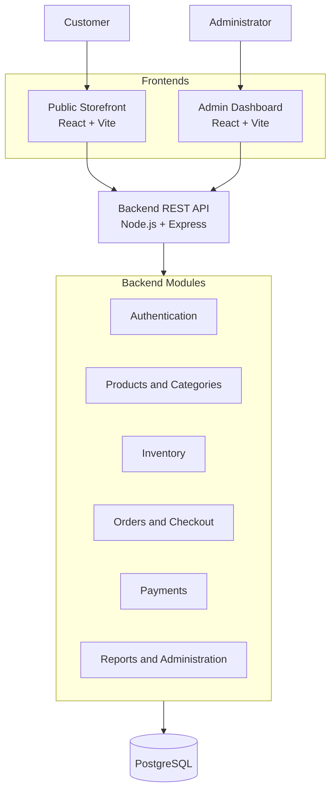
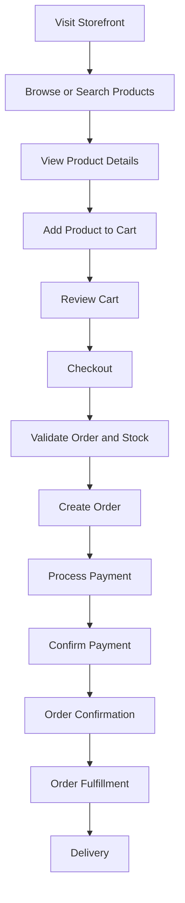
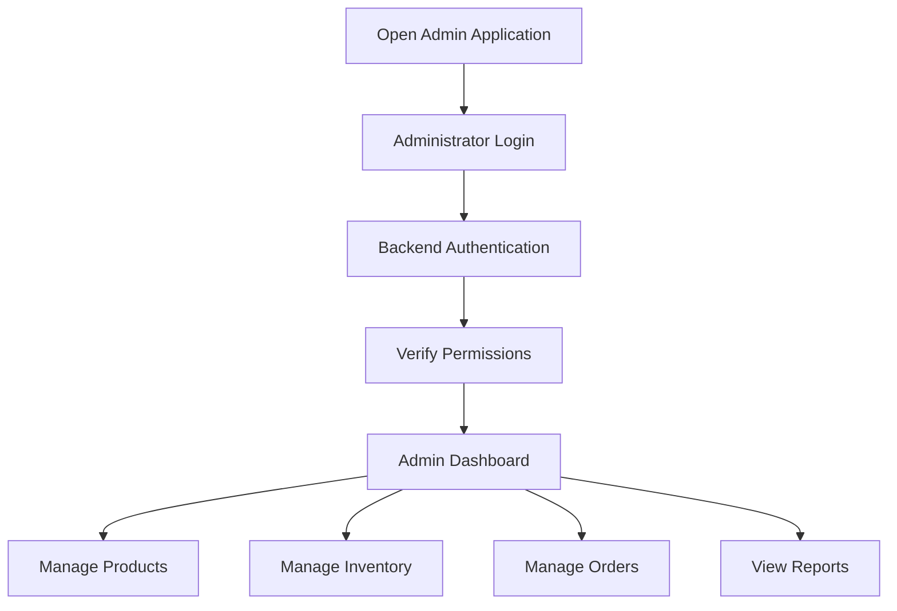

# Gadget Store E-commerce System

A full-stack electronics e-commerce platform designed to help customers discover and purchase electronic products while enabling store administrators to manage products, inventory, orders, payments, and business operations through a separate administration dashboard.

---

## 1. Project Overview

The Gadget Store E-commerce System is a web-based platform consisting of four main components:

1. **Public Storefront:** The customer-facing application for browsing products, searching, managing shopping carts, and placing orders.
2. **Admin Dashboard:** A separate application for managing products, categories, inventory, customers, orders, and store operations.
3. **Backend API:** The central application responsible for business logic, authentication, authorization, order processing, and communication between the frontends and database.
4. **Database:** The persistent storage layer responsible for maintaining application data and relationships.

The system will initially be developed as a functional MVP, with an architecture that supports future enhancements and production deployment.

## 2. Project Objectives

The main objectives are to:

- Build a responsive and user-friendly electronics shopping experience.
- Provide a centralized product and inventory management system.
- Enable customers to add products to a cart and place orders.
- Provide administrators with tools to manage store operations.
- Implement secure authentication and role-based authorization.
- Maintain accurate product, inventory, order, and payment records.
- Establish a maintainable and scalable application architecture.
- Create a system that can be customized and deployed for different electronics retailers.

## 3. Target Users

| User | Responsibilities |
|---|---|
| Guest visitor | Browse products, search, view product details, and place guest orders. |
| Registered customer | Manage an account, place orders, and view order history. |
| Administrator | Manage products, categories, inventory, orders, and store settings. |
| Inventory staff | Monitor stock and update inventory records. |
| Order fulfillment staff | Process orders and update delivery statuses. |

Access to administrative functionality must be enforced by the backend, not merely hidden in the frontend.

## 4. Core Features

### 4.1 Public Storefront

- Homepage with featured products and categories.
- Product catalog.
- Product search.
- Product filtering and sorting.
- Product detail pages with specifications and images.
- Shopping cart.
- Guest checkout.
- Optional customer registration and login.
- Order confirmation.
- Order status tracking.
- Responsive design for mobile, tablet, and desktop.

### 4.2 Admin Dashboard

- Secure administrator authentication.
- Dashboard overview and business metrics.
- Product management.
- Category management.
- Inventory management.
- Order management.
- Payment record management.
- Customer management.
- Basic sales and inventory reports.
- Staff accounts and permissions.
- Store configuration.

### 4.3 Backend API

- Authentication and authorization.
- Product and category management.
- Cart and checkout processing.
- Order creation and management.
- Inventory validation and updates.
- Payment processing workflows.
- Delivery configuration.
- Input validation and error handling.
- API logging and monitoring.

## 5. MVP Scope

The first release will focus on the essential features needed to demonstrate a complete shopping and store-management workflow.

| Feature | Priority |
|---|---|
| Product catalog | Must have |
| Product search and filtering | Must have |
| Product details | Must have |
| Shopping cart | Must have |
| Guest checkout | Must have |
| Customer authentication | Must have |
| Admin authentication and permissions | Must have |
| Product and category management | Must have |
| Inventory management | Must have |
| Order management | Must have |
| Configurable delivery charges | Must have |
| Simulated payment workflow | Must have |
| Basic reports | Must have |
| Product reviews | Future enhancement |
| Wishlist | Future enhancement |
| Discounts and promotions | Future enhancement |
| Advanced analytics | Future enhancement |

**MVP payment approach:** Begin with simulated payments to validate the complete order lifecycle. Integrate real payment providers, including M-Pesa where appropriate, after the core workflow is reliable.

## 6. Technology Stack

| Layer | Technology | Purpose |
|---|---|---|
| Storefront | React + Vite | Customer-facing interface |
| Admin dashboard | React + Vite | Administrative interface |
| Routing | React Router | Frontend navigation |
| Styling | CSS Modules / CSS | Component and interface styling |
| Backend | Node.js + Express.js | REST API and business logic |
| Language | JavaScript (ES Modules) | Application development |
| Database | PostgreSQL | Persistent data storage |
| ORM | Prisma | Database access and migrations |
| Validation | Zod | Request and data validation |
| Testing | Vitest, React Testing Library, Playwright | Automated testing |
| Version control | Git + GitHub | Source control and collaboration |

Additional infrastructure such as Redis, background workers, object storage, and a CDN can be introduced when justified by actual requirements.

## 7. System Architecture

The project follows a **modular monolith backend architecture** with independently deployed frontend applications.



### Architecture Principles

- The storefront and admin dashboard are separate frontend applications.
- Both frontends communicate with the backend through the REST API.
- The backend is the only application layer that accesses the database.
- Business rules are enforced on the backend.
- Administrative permissions are verified server-side.
- The backend is organized into independent business modules.
- The architecture should remain simple until complexity justifies additional infrastructure.

## 8. Application Structure

The proposed repository structure is a monorepo containing the two frontend applications, backend API, shared packages, and documentation.

```text
gadget-store/
│
├── apps/
│   ├── storefront/
│   │   └── Customer-facing React application
│   │
│   ├── admin/
│   │   └── Administration React application
│   │
│   └── api/
│       └── Express backend application
│
├── packages/
│   ├── shared/
│   │   └── Shared utilities and definitions
│   │
│   ├── validation/
│   │   └── Shared validation schemas
│   │
│   └── config/
│       └── Shared configuration
│
├── docs/
│   ├── 01-product-requirements.md
│   ├── 02-technical-requirements.md
│   ├── 03-application-flow.md
│   ├── 04-design-brief.md
│   ├── 05-backend-schema.md
│   └── 06-implementation-plan.md
│
├── .gitignore
├── README.md
└── package.json
```

This is the planned structure. Individual application folders will be populated as development progresses.

## 9. Backend Modules

The backend will be organized around business responsibilities.

| Module | Responsibility |
|---|---|
| Authentication | Registration, login, sessions, and access control |
| Users | Customer and staff account management |
| Products | Product information and specifications |
| Categories | Product classification |
| Inventory | Stock levels and inventory movements |
| Cart | Shopping cart operations |
| Orders | Order creation and lifecycle management |
| Payments | Payment records and payment status |
| Shipping | Delivery methods, charges, and tracking |
| Reports | Sales and inventory summaries |
| Administration | Store configuration and administrative operations |

## 10. Database Overview

PostgreSQL will be used as the primary relational database.

Initial entities to evaluate include:

- Users
- Roles
- Permissions
- Categories
- Products
- Product images
- Product variants (if required)
- Inventory
- Inventory movements
- Addresses
- Carts
- Cart items
- Orders
- Order items
- Payments
- Payment events
- Shipments
- Discounts (when introduced)
- Audit logs

The final schema will be determined by the approved product requirements and business rules.

### Data Integrity Principles

- Every product should have a unique SKU.
- Product prices and quantities must be validated.
- Order items should preserve product and price information at purchase time.
- Inventory changes must be traceable.
- Stock updates must be safe under concurrent purchases.
- Payment events must be protected against duplicate processing.
- Sensitive customer information must be access-controlled.

## 11. Security Requirements

Security is a core requirement across all application components.

The system must implement:

- Secure password hashing.
- Authentication and session/token management.
- Backend-enforced role-based access control.
- Request validation and sanitization.
- Rate limiting and login protection.
- Secure environment variable management.
- Protection against unauthorized administrative access.
- Payment callback verification.
- Idempotent order and payment operations.
- Audit logging for important administrative actions.
- Database backups and recovery procedures.

Payment credentials and secrets must never be exposed in frontend applications or committed to version control.

## 12. Application Workflows

### Customer Shopping Workflow



### Administrator Workflow



The backend must validate prices, stock availability, payment status, and permissions regardless of what the frontend displays.

## 13. Development Roadmap

Development will follow a phased approach.

| Phase | Description | Expected Outcome |
|---|---|---|
| 1 | Requirements and architecture | Approved planning documents |
| 2 | Repository and environment setup | Development environment ready |
| 3 | UI foundations | Storefront and admin interface foundations |
| 4 | Database and catalog | Product and category functionality |
| 5 | Authentication and authorization | Secure user and admin access |
| 6 | Cart and checkout | Working order creation workflow |
| 7 | Inventory and administration | Stock and order management |
| 8 | Payment integration | Simulated payment workflow |
| 9 | Background processing and caching | Reliable supporting operations where needed |
| 10 | Testing and hardening | Verified functionality and security |
| 11 | Deployment | Deployed demonstration |
| 12 | Production preparation | Production readiness and operational procedures |

Each phase must have clear deliverables, dependencies, and acceptance criteria before moving forward.

## 14. Testing Strategy

The project will use several testing levels:

- **Unit testing:** Validate individual business rules and functions.
- **Integration testing:** Verify API endpoints and database interactions.
- **Component testing:** Validate frontend components and interactions.
- **End-to-end testing:** Test complete customer and administrator workflows.
- **Security testing:** Verify authentication, authorization, and input handling.
- **Concurrency testing:** Check inventory consistency during simultaneous purchases.
- **Payment testing:** Verify failed, repeated, delayed, and duplicate payment events.
- **Responsive testing:** Check mobile, tablet, and desktop layouts.

## 15. Deployment and Infrastructure

The project will use separate deployment environments for development, testing, and production.

Planned infrastructure:

- Frontend hosting for the storefront.
- Separate frontend hosting for the admin dashboard.
- Backend hosting for the Express API.
- Managed PostgreSQL database.
- Object storage for product images.
- CDN for static assets and product media.
- Automated database backups.
- Application monitoring and error logging.
- CI/CD pipeline for testing and deployment.

Production deployment must include secure environment configuration, domain and HTTPS setup, database migration procedures, monitoring, and recovery planning.

## 16. Future Enhancements

After the MVP is stable, the platform may be extended with:

- Product reviews and ratings.
- Customer wishlists.
- Product comparison.
- Discount codes and promotions.
- Advanced analytics.
- Automated low-stock notifications.
- Courier and delivery service integrations.
- Additional payment providers.
- Personalized product recommendations.
- Advanced product search.
- Customer loyalty features.

These enhancements should be prioritized based on business value and user feedback.

## 17. Project Success Criteria

The project will be considered successful when:

### Functional Success
- Customers can discover products and place orders.
- Administrators can manage products and inventory.
- Orders can move through a clearly defined lifecycle.
- Payment statuses are accurately recorded.
- Administrative access is properly protected.

### Technical Success
- Frontend and backend responsibilities are clearly separated.
- Database relationships and constraints maintain data integrity.
- Core workflows are covered by automated tests.
- The system handles errors and invalid requests appropriately.
- The application can be deployed and maintained reliably.

### Business Success
- The platform demonstrates a complete electronics retail workflow.
- The system can be customized for different electronics retailers.
- The application provides a foundation for future business growth.

## 18. Documentation

The project is supported by six planning documents:

| Document | Purpose |
|---|---|
| 01 — Product Requirements Document | Defines what the system should achieve |
| 02 — Technical Requirements Document | Defines the technologies and technical architecture |
| 03 — Application Flow Document | Defines user journeys and application behavior |
| 04 — Design Brief Document | Defines the visual identity and interface experience |
| 05 — Backend Schema Document | Defines the database structure and relationships |
| 06 — Implementation Plan | Defines the development sequence and tasks |

These documents should remain consistent. Changes to core features, business rules, architecture, or data structures should be reviewed across the relevant documents.

---

## 19. Current Development Status

<details>
<summary>Project planning and development checklist</summary>

- [x] Product Requirements Document drafted
- [x] Technical Requirements Document drafted
- [x] Application Flow Document drafted
- [x] Design Brief requirements established
- [x] Backend Schema requirements established
- [x] Implementation Plan drafted
- [ ] Complete cross-document review
- [ ] Finalize database and business-rule decisions
- [ ] Establish repository and development environment
- [ ] Begin implementation phases
- [ ] Complete MVP testing
- [ ] Deploy demonstration version
- [ ] Prepare for production launch

</details>

## 20. Development Philosophy

The project will follow these principles:

1. Plan before implementation.
2. Build the MVP before advanced features.
3. Keep the storefront, admin dashboard, backend, and database responsibilities separate.
4. Enforce business rules on the backend.
5. Prioritize data consistency and security.
6. Build reusable and maintainable components.
7. Test important workflows continuously.
8. Avoid unnecessary complexity and premature optimization.
9. Document important architectural and business decisions.
10. Expand the system based on validated requirements.

---

**Project:** Gadget Store E-commerce System  
**Project Type:** Full-Stack Web Application  
**Architecture:** Separate Storefront + Admin Dashboard + Modular Monolith API  
**Status:** Planning and pre-implementation  
**Primary Goal:** Build a maintainable, secure, and extensible electronics e-commerce platform.